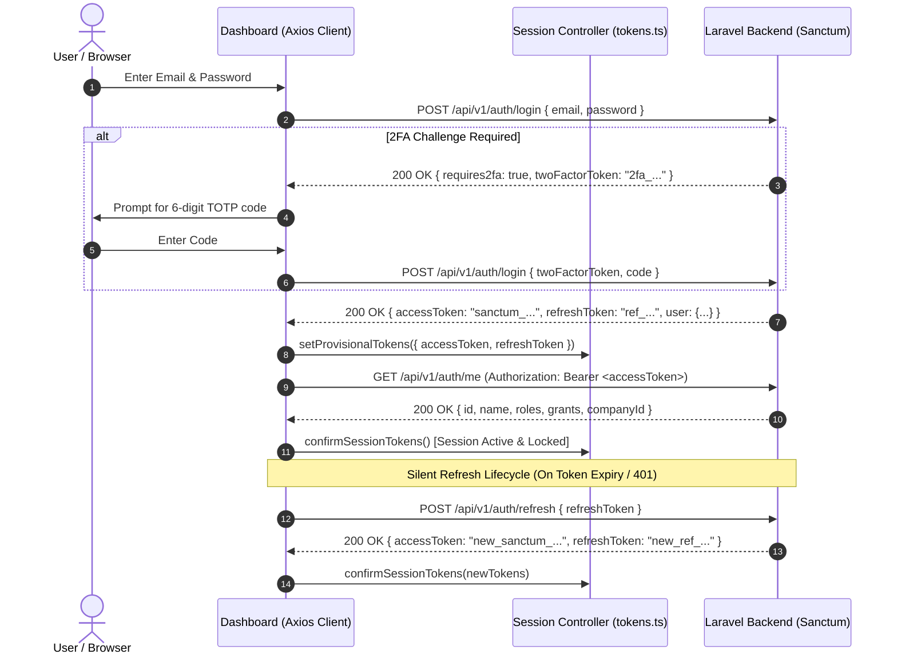

# ASSAB ERP — Phase 3: Functional Integration Readiness Matrix
**Document Version:** 2.2 (Reconciled with Backend Modules/Admin/routes/api.php & Frontend Call Sites)
**Governance Reference:** ASSAB Business Rules v3.5 (2026-10-21) & Backend API Contract Specification
**Status:** READ-ONLY CONTRACT AUDIT & PREPARATION — NO STAGING MUTATION AUTHORIZED

---

## 1. Executive Summary & Governance Classification

This matrix documents the comprehensive contract mapping, multi-tenancy boundaries, payload structures, authentication lifecycle, and staging verification requirements for ASSAB ERP across all 7 dashboard roles.

### Operational Classification Categories:
1. **Read-Only (RO):** Safe data fetches, metrics queries, report views. No backend state changes. Testable locally via contract mocks and safely on Staging without rollback requirements.
2. **State-Changing (SC):** Configuration changes, user creation, role assignment, item definitions, filters, reminders, order confirmations. Changes application state but does not alter financial balances or ledgers.
3. **Financial / Sensitive (FS):** Operations pipeline state transitions (`submit` → `review` → `approved` → `final-approved` → `erp-posted`), daily sales reconciliations, cash custody disbursements, shift variance assignments, expense invoice verification, fixed asset capitalizations, and ERP export batch creation. **MANDATORY: Requires confirmed server response, halala integer precision, idempotent headers, and explicit authorization.**

### Verified Operations Count (Audit Reconciled):
- **Core 41 Baseline Operations (Accountant, Head Accountant, Platform Admin, Procurement, Branch Manager):**
  - **Read-Only (RO):** 23 operations
  - **State-Changing (SC):** 6 operations
  - **Financial / Sensitive (FS):** 12 operations
  - **Subtotal:** 23 + 6 + 12 = **41 operations**
- **Extension for Company Admin & Supplier Portal Roles (All 7 Roles Comprehensive):**
  - **Company Admin:** 5 Read-Only + 2 State-Changing = 7 operations (including Invitations list)
  - **Supplier Portal:** 2 Read-Only + 2 State-Changing = 4 operations *(Gated behind `SUPPLIER_PORTAL_ENABLED`)*
  - **Grand Total Across All 7 Roles:** 30 Read-Only + 10 State-Changing + 12 Financial/Sensitive = **52 operations**

---

## 2. Comprehensive Contract Mapping Matrix (All 7 Roles)

### 2.1 Core 41 Operations (Accountant, Head Accountant, Platform Admin, Procurement, Branch Manager)

| Role | Module | Page / Screen | Functionality | Actual API Endpoint | Method | Request Payload / Params | Business Rule v3.5 Ref | Scope Boundary | Classification |
|---|---|---|---|---|---|---|---|---|---|
| **Accountant** | Dashboard | `acc-dashboard` | Fetch pipeline stages & KPI overview | `/company/me/operations/overview` | `GET` | `dateFrom`, `dateTo`, `brandId` | §4.1 (Operations Pipeline) | Assigned Brands | **Read-Only (RO)** |
| **Accountant** | Sales | `acc-sales` | Fetch sales statements & completeness | `/company/me/sales/day-completeness` | `GET` | `days` (default 7) | §4.2 (Daily Sales) | Assigned Branches | **Read-Only (RO)** |
| **Accountant** | Sales | `acc-sales` | Fetch sales financial KPIs & variance | `/company/me/sales/kpis` | `GET` | `date` | §4.2 (Sales Variance) | Assigned Brands | **Read-Only (RO)** |
| **Accountant** | Sales | `acc-sales-detail` | Reconcile daily sales figures & payment channels | `/company/me/operations/{id}/sales-details` | `PATCH` | `{ cashHalalas, cardHalalas, aggregatorHalalas, notes }` | §4.2.3 (Sales Reconciliation) | Operation Branch | **Financial / Sensitive (FS)** |
| **Accountant** | Sales | `acc-sales-detail` | Assign sales variance to cashier/crew | `/company/me/operations/{id}/sales-variance/assign` | `POST` | `{ employeeId, amountHalalas, reason }` | §4.2.4 (Variance Allocation) | Operation Branch | **Financial / Sensitive (FS)** |
| **Accountant** | Expenses | `acc-expenses` | Fetch expense statements & VAT metrics | `/company/me/expenses/kpis` | `GET` | `dateFrom`, `dateTo` | §5.1 (Expense & VAT 15%) | Company Scope | **Read-Only (RO)** |
| **Accountant** | Expenses | `acc-expenses` | Verify/Document expense tax invoice | `/company/me/expense-invoices/{id}/verify` | `POST` | `{ invoiceIndex }` | §5.2 (ZATCA / Tax Invoice) | Operation Branch | **Financial / Sensitive (FS)** |
| **Accountant** | Expenses | `acc-expenses` | Review & update expense document data | `/company/me/expense-invoices/{id}/invoices/{idx}` | `PATCH` | `{ documentAmountHalalas, documentVendor, documentInvNum, documentDate }` | §5.2.2 (Invoice Audit) | Operation Branch | **Financial / Sensitive (FS)** |
| **Accountant** | Expenses | `acc-expenses` | Convert expense line to Fixed Asset draft | `/company/me/assets/drafts` | `POST` | `{ invoiceId, invoiceIndex, assetName, category, usefulLifeMonths, targetBranches, custodian, qty }` | §5.3 (Asset Capitalization) | Company Scope | **Financial / Sensitive (FS)** |
| **Accountant** | Purchases | `acc-purchases` | Fetch purchase orders & supplier invoices | `/company/me/operations` | `GET` | `moduleKey=purchases`, `groupBy`, `status`, `match` | §6.1 (Procurement & PO) | Assigned Brands | **Read-Only (RO)** |
| **Accountant** | Inventory | `acc-inventory` | Fetch branch inventory reviews & variance | `/company/me/inventory/branches` | `GET` | `date`, `brandId` | §7.1 (Stock Reconciliation) | Assigned Branches | **Read-Only (RO)** |
| **Accountant** | Inventory | `acc-inventory-items` | Update branch daily inventory count list | `/company/me/branches/{id}/inventory-list` | `PUT` | `{ items: string[] }` | §7.2 (Daily Count Sheet) | Specific Branch | **State-Changing (SC)** |
| **Accountant** | Cash Custody | `acc-cash` | Fetch petty cash custody ledger | `/company/me/cash-custody` | `GET` | `branchId`, `status` | §8.1 (Petty Cash Float) | Assigned Branches | **Read-Only (RO)** |
| **Accountant** | Cash Custody | `acc-cash` | Disburse cash transaction (Direct Debit) | `/company/me/cash-custody/{id}/transactions` | `POST` | `{ type: "disbursement", amountHalalas, category, description, receiptAttachmentId }` | §8.2 (Cash Disbursement) | Custody Float | **Financial / Sensitive (FS)** |
| **Accountant** | Shifts | `acc-shifts` | Fetch active & overdue cashier shifts | `/accountant/shifts/live` | `GET` | — | §9.1 (Cashier Shifts) | Assigned Branches | **Read-Only (RO)** |
| **Accountant** | Shifts | `acc-shifts` | Close cashier shift & record variance | `/accountant/shifts/{id}/close` | `POST` | `{ actualCashHalalas, notes }` | §9.2 (Shift Closure & Z-Report) | Specific Shift | **Financial / Sensitive (FS)** |
| **Accountant** | Shifts | `acc-shifts` | Correct shift Z-report discrepancy | `/accountant/shifts/{id}/correct` | `POST` | `{ correctedAmountHalalas, justification }` | §9.3 (Audit Correction) | Specific Shift | **Financial / Sensitive (FS)** |
| **Accountant** | Waste | `acc-waste` | Fetch food waste & shrinkage records | `/company/me/operations` | `GET` | `moduleKey=waste` | §10.1 (Waste Valuation) | Assigned Brands | **Read-Only (RO)** |
| **Accountant** | Employees | `acc-employees` | Fetch employee accounts, advances & loans | `/company/me/employees` | `GET` | `branchId`, `status` | §11.1 (Payroll & Advances) | Company Scope | **Read-Only (RO)** |
| **Accountant** | Operations | Universal | Approve operation (Move to Head review) | `/company/me/operations/{id}/approve` | `POST` | `{ notes }` | §3.2 (Accountant Approval) | Assigned Scope | **Financial / Sensitive (FS)** |
| **Accountant** | Operations | Universal | Reject operation (Return to Branch manager) | `/company/me/operations/{id}/reject` | `POST` | `{ reason }` | §3.3 (Rejection Workflow) | Assigned Scope | **Financial / Sensitive (FS)** |
| **Head Accountant** | Dashboard | `head-dashboard` | Multi-brand executive overview & KPIs | `/company/me/head/dashboard` | `GET` | — | §2.1 (Head Oversight) | Entire Company | **Read-Only (RO)** |
| **Head Accountant** | Pending Queue | `head-pending` | Review accountant-approved operations | `/operations` | `GET` | `status=approved` | §3.4 (Head Approval Queue) | Entire Company | **Read-Only (RO)** |
| **Head Accountant** | Pending Queue | `head-pending` | Final Approve operation (Eligible for ERP) | `/company/me/operations/{id}/final-approve` | `POST` | `{ notes, isConditional? }` | §3.5 (Final Approval Gate) | Entire Company | **Financial / Sensitive (FS)** |
| **Head Accountant** | ERP Export | `head-erp` | Fetch ERP export batches & preflight | `/company/me/head/erp/preflight` | `GET` | `moduleKey` | §12.1 (ERP Batching) | Entire Company | **Read-Only (RO)** |
| **Head Accountant** | ERP Export | `head-erp` | Create ERP export posting batch | `/company/me/erp/batches` | `POST` | `{ moduleKey, operationIds[] }` | §12.2 (GL Posting Batch) | Entire Company | **Financial / Sensitive (FS)** |
| **Admin** | Overview | `admin-overview` | Tenant statistics & brand hierarchy | `/admin/overview` | `GET` | — | §1.1 (Platform Tenancy) | Platform / Company | **Read-Only (RO)** |
| **Admin** | Users | `admin-users` | List & filter company users & roles | `/admin/users` | `GET` | `role`, `status`, `search` | §1.2 (RBAC Provisioning) | Platform / Company | **Read-Only (RO)** |
| **Admin** | Users | `admin-users` | Create user with explicit brand/branch grants | `/admin/users` | `POST` | `{ name, email, phone, role, brands[], branches[], modules[] }` | §1.2 (Multi-Branch Grants) | Platform / Company | **State-Changing (SC)** |
| **Admin** | Brands | `admin-restaurants` | Manage brand portfolio & branch hierarchy | `/admin/brands` | `GET` | — | §1.3 (Organizational Tree) | Platform / Company | **Read-Only (RO)** |
| **Admin** | Subscriptions | `admin-subscriptions`| Platform tenant subscriptions & billing plans | `/admin/subscriptions` | `GET` | — | §1.4 (Platform SaaS Subscriptions) | Platform Scope | **Read-Only (RO)** |
| **Admin** | Permissions | `admin-permissions` | Role-Permission access matrix | `/admin/permissions/matrix` | `GET` | — | §1.5 (Security Matrix) | Platform Scope | **Read-Only (RO)** |
| **Admin** | Permissions | `admin-permissions` | Update module access rights per role | `/admin/permissions/matrix` | `PUT` | `{ matrix: Record<Role, string[]> }` | §1.5 (Security Matrix) | Platform Scope | **State-Changing (SC)** |
| **Procurement** | Overview | `proc-overview` | Procurement KPIs & supplier activity | `/company/me/procurement/overview` | `GET` | — | §13.1 (Procurement Hub) | Company Scope | **Read-Only (RO)** |
| **Procurement** | Orders | `proc-orders` | List purchase requests & order statuses | `/company/me/procurement/orders` | `GET` | `status`, `supplierId` | §13.2 (Purchase Orders) | Company Scope | **Read-Only (RO)** |
| **Procurement** | Catalog | `proc-items` | Master catalog items & standard pricing | `/company/me/procurement/items` | `GET` | `search`, `category` | §13.3 (Item Catalog) | Company Scope | **Read-Only (RO)** |
| **Procurement** | Catalog | `proc-items` | Add/Update catalog item with default vendor | `/company/me/procurement/items` | `POST` | `{ name, category, unit, defaultPriceHalalas, preferredSupplierId }` | §13.3 (Catalog Management) | Company Scope | **State-Changing (SC)** |
| **Procurement** | Suppliers | `proc-suppliers` | Master supplier directory & ratings | `/company/me/procurement/suppliers` | `GET` | — | §13.4 (Vendor Directory) | Company Scope | **Read-Only (RO)** |
| **Branch Manager**| Dashboard | `branch-dashboard` | Daily shift tasks & required uploads | `/branch/overview` | `GET` | — | §14.1 (Branch Daily Hub) | Single Branch | **Read-Only (RO)** |
| **Branch Manager**| Uploads | `branch-upload` | Upload daily Z-report / invoices / sheets | `/branch/upload` | `POST` | `multipart/form-data: { file, type, date }` | §14.2 (Branch Submissions) | Single Branch | **State-Changing (SC)** |
| **Branch Manager**| Settings | `branch-settings` | Configure branch operating hours & profile | `/company/me/branch/settings` | `PATCH` | `{ openTime, closeTime, notificationPhones[] }` | §14.3 (Branch Config) | Single Branch | **State-Changing (SC)** |

---

### 2.2 Extension: Company Admin & Supplier Portal Operations

| Role | Module | Page / Screen | Functionality | Actual API Endpoint | Method | Request Payload / Params | Business Rule v3.5 Ref | Scope Boundary | Classification |
|---|---|---|---|---|---|---|---|---|---|
| **Company Admin**| Overview | `company-admin-dashboard` | Executive KPI rollup & real storage quota | `/company/me/dashboard` | `GET` | — | §1.1 (Company Tenancy) | Entire Company | **Read-Only (RO)** |
| **Company Admin**| Subscriptions| `admin-subscriptions` | Current plan, billing cycle & addon usage | `/company/me/subscription` | `GET` | — | §1.4 (SaaS Subscription) | Company Scope | **Read-Only (RO)** |
| **Company Admin**| Users | `admin-users` | Filter users & active role grants | `/company/me/users` | `GET` | `role`, `status` | §1.2 (User Directory) | Company Scope | **Read-Only (RO)** |
| **Company Admin**| Users | `admin-users` | List pending company invitations | `/company/invitations` | `GET` | — | §1.2 (Company Invitations) | Company Scope | **Read-Only (RO)** |
| **Company Admin**| Users | `admin-users` | Send user invitation with roleKey & grant | `/company/invitations` | `POST` | `{ email, name?, roleKey, branchId? }` | §1.2 (Role Invitations) | Company Scope | **State-Changing (SC)** |
| **Company Admin**| Brands & Org | `admin-restaurants` | Brand tree, restaurants & assigned branches | `/company/me/brands` | `GET` | — | §1.3 (Org Structure) | Company Scope | **Read-Only (RO)** |
| **Company Admin**| Settings | `admin-settings` | Company preferences & currency formatting | `/company/me/settings` | `PATCH` | `{ name, timeZone, phone, vatNumber }` | §1.6 (Company Config) | Company Scope | **State-Changing (SC)** |
| **Supplier** | Portal | `supplier-dashboard` | Supplier orders overview & status *(Gated)* | `/asab/supplier/overview` | `GET` | — | §15.1 (Supplier Hub) | Supplier Account | **Read-Only (RO)** |
| **Supplier** | Orders | `supplier-orders` | View received POs from restaurants *(Gated)* | `/asab/supplier/orders` | `GET` | `status` | §15.2 (Vendor Orders) | Supplier Account | **Read-Only (RO)** |
| **Supplier** | Orders | `supplier-orders` | Acknowledge & accept PO delivery *(Gated)* | `/asab/supplier/orders/{id}/accept` | `POST` | `{ deliveryDate, notes }` | §15.3 (PO Acceptance) | Specific PO | **State-Changing (SC)** |
| **Supplier** | Invoices | `supplier-invoices` | Submit tax invoice against delivered PO *(Proposed)* | `/asab/supplier/orders/{id}/submit-invoice` | `POST` | `{ poId, invoiceNumber, amountHalalas, fileAttachmentId }` | §15.4 (Vendor Invoice) | Specific PO | **State-Changing (SC) [NOT VERIFIED — PROPOSED]** |

> [!NOTE]
> **Reconciled Backend Route & Frontend Call Site Ground Truth:**
> - **Company Invitations:** Frontend call site `useCompanyInvitations` and `useCreateCompanyInvitation` in `src/api/queries/companyAdmin.ts:167–205` target `GET /company/invitations` and `POST /company/invitations`. Backend route in `Modules/Admin/routes/api.php:127–128` is `Route::get('invitations', [CompanyUserController::class, 'invitations'])` and `Route::post('invitations', [CompanyUserController::class, 'invite'])` under `prefix('company')`. Role keys are `"company-admin" | "head" | "accountant" | "branch" | "procurement"`. Invitation acceptance is public at `POST /api/v1/company/invitations/accept` (`OnboardController::acceptInvitation`).
> - **Head Final Approval:** Backend route in `Modules/Admin/routes/api.php:260` is `Route::post('operations/{id}/final-approve', [OperationController::class, 'finalApprove'])->middleware(['asab.role:head', 'asab.idempotency'])` under `prefix('company/me')`. Bulk final approval route is `POST /api/v1/company/me/operations/bulk-final-approve`.
> - **ERP Export Pipeline:** Head Accountant batch generation route in `Modules/Admin/routes/api.php:333` is `Route::post('erp/batches', [HeadController::class, 'erpCreateBatch'])->middleware(['asab.role:head', 'asab.idempotency'])` under `prefix('company/me')`. Head preflight is `GET /api/v1/company/me/head/erp/preflight` (`HeadController::erpPreflight`). Platform Admin ERP export is `POST /api/v1/admin/erp/export` (`ErpAdminController::export`).
> - **Subscriptions Distinction:** Platform Super Admin subscriptions route in `Modules/Admin/routes/api.php:191` is `GET /api/v1/admin/subscriptions` (`SubscriptionController::index`). Tenant subscription for Company Admin in `Modules/Admin/routes/api.php:627` is `GET /api/v1/company/me/subscription` (`CompanySubscriptionController::show`).
> - **Company Admin Overview:** Backend route in `Modules/Admin/routes/api.php:621` is `Route::get('me/dashboard', [CompanyDashboardController::class, 'index'])` under `prefix('company')`, resolving to canonical URL `/api/v1/company/me/dashboard`.
> - **Branch Settings:** Backend route in `Modules/Admin/routes/api.php:912` is `Route::patch('settings', [BranchDashboardController::class, 'updateSettings'])` under `prefix('company/me/branch')` (resolving to `/api/v1/company/me/branch/settings` with alias `/api/v1/branch/settings`).
> - **Supplier Portal:** Backend routes in `Modules/Admin/routes/api.php:582–607` are namespaced under `prefix('asab/supplier')` with controller `Modules\Admin\Http\Controllers\Supplier\SupplierController`. The PO acceptance action is `POST /api/v1/asab/supplier/orders/{id}/accept` (named `accept`, NOT `confirm`). Invoice submission endpoint is strictly segregated as **`NOT VERIFIED — PROPOSED`** pending backend endpoint implementation. All supplier routes require backend feature flag `FEATURE_ASAB_SUPPLIER_PORTAL=true` and frontend `SUPPLIER_PORTAL_ENABLED=true`.

---

## 3. Authentication & Secure Session Lifecycle (Laravel Sanctum)

ASSAB ERP utilizes **Laravel Sanctum Personal Access Tokens** with strict frontend session control. It does **NOT** rely on an external OAuth 2.0 Authorization Server / OpenID Connect provider.

### Key Sanctum Security Rules:
1. **Bearer Token Transport:** All authenticated requests pass `Authorization: Bearer <sanctum_token>` injected via Axios interceptors.
2. **Session Generation Race Protection (`activeFinancialSession`):** If a user logs in concurrently on another tab or logs out, provisional tokens from an older session cannot overwrite or clear the active session.
3. **Fail-Closed RBAC:** In the absence of a valid role grant or upon receiving HTTP 401/403, the dashboard immediately triggers `clearSessionTokensIfCurrent()` and transitions to the unauthorized fail-closed screen.

---

## 4. Multi-Tenancy & Authorization Boundaries

1. **Company Isolation (`company_id`):** Multi-tenant boundary is enforced at the database query level in Laravel. Cross-company access is strictly rejected with `403 FORBIDDEN`.
2. **Brand Grants (`brand_ids`):** Accountants assigned to Brand A receive `403 WRONG_BRAND` if requesting Brand B data.
3. **Branch Boundaries (`branch_ids`):** Branch Managers are hard-bound to exactly 1 branch (`branchIds.length === 1`).
4. **Segregation of Duties (SoD):**
   - The creator of an operation cannot approve it.
   - The reviewing Accountant (`approved`) cannot issue the Head Accountant's final approval (`final-approved`).
   - Posting to ERP (`erp-posted`) requires explicit Head Accountant clearance.

---

## 5. Staging Readiness & Test Prerequisites (No Accounts Created Yet)

> [!IMPORTANT]
> **No staging accounts have been created and no staging data has been modified during this audit phase.** The requirements below specify the exact prerequisites needed when staging execution is explicitly authorized.

### 7 Canonical Dashboard Roles & Multi-Brand Test Personas:

The dashboard defines **7 distinct RBAC roles** in its frontend architecture (`src/featureFlags.ts` & role profiles):
1. `admin` (Platform Super Admin)
2. `company_admin` (Company Administrator)
3. `head_accountant` (Head Accountant)
4. `accountant` (Accountant)
5. `procurement` (Procurement Manager)
6. `branch_manager` (Branch Manager)
7. `supplier` (Supplier Portal User — gated behind `SUPPLIER_PORTAL_ENABLED`)

To rigorously verify multi-tenant isolation and cross-brand boundary enforcement (§4.2 / §1.2), **8 test personas** are mapped across these 7 roles for future staging verification:
1. **Platform Super Admin (`admin`):** `admin.platform@assab-staging.com` (Multi-tenant governance, company activation).
2. **Company Admin (`company_admin`):** `admin.romansiah@assab-staging.com` (User provisioning, branch settings, brand tree).
3. **Head Accountant (`head_accountant`):** `head.acc@romansiah-staging.com` (Multi-brand oversight, final approval queue, ERP export preflight).
4. **Accountant A (`accountant` — Brand 1 / Fast Food):** `acc.fastfood@romansiah-staging.com` (Sales reconciliation, petty cash, branch daily audits).
5. **Accountant B (`accountant` — Brand 2 / Fine Dining):** `acc.finedining@romansiah-staging.com` (Cross-brand boundary tests, supplier invoices, inventory variance).
6. **Procurement Manager (`procurement`):** `procurement@romansiah-staging.com` (Catalog management, vendor PO grouping).
7. **Branch Manager (`branch_manager` — Olaya Branch):** `branch.olaya@romansiah-staging.com` (Daily uploads, shift closures, stock count).
8. **Supplier Portal User (`supplier`):** `supplier.almarai@assab-staging.com` (PO receipt, fulfillment status, gated by `SUPPLIER_PORTAL_ENABLED`).

### Required Staging Data Fixtures:
- **Company & Brands:** At least 2 active brands under Company ID `11111111-1111-1111-1111-111111111111`.
- **Branches:** At least 3 active branches (Olaya, Yasmin, Rawdah).
- **Daily Operations:** 5 Sales statements (Exact match, Cashier Shortage, Cashier Surplus), 4 Expense invoices (2 Matched ZATCA, 1 Mismatch, 1 Missing doc), 3 Purchase orders (Draft, Approved, Invoiced), 2 Petty cash custody accounts (1 Normal, 1 Over 85%), 2 Cashier shifts (1 Open, 1 Closed with variance).
- **Chart of Accounts:** Saudi ZATCA-compliant COA with integer halala balances.

---

## 6. Verification Protocols: Local vs Staging Distinction

| Test Category | Description | Local Mock Status | Real Staging Status |
|---|---|---|---|
| **Contract Schema & DTO Alignment** | AST analysis, payload typing, error envelope matching | **PASS¹ (117 / 117 tests exit 0)** | **Gated (Pending Staging Access)** |
| **Visual / Responsive Layout** | 8 viewports (320px–1280px), AR RTL & EN LTR, zero clipping | **PASS¹ (Verified 304/304)** | **Gated (Browser QA on Staging)** |
| **Sanctum Auth & Session Lifecycle** | Token storage, refresh, 2FA challenge, race guards | **PASS¹ (Contract Verified)** | **Gated (Live Sanctum DB Auth)** |
| **Multi-Tenant RBAC & Boundaries** | Unauthorized role wall, 401/403 fail-closed responses | **PASS¹ (Contract Verified)** | **Gated (Live User Permission Test)** |
| **Financial Mutations (FS)** | Halala integer precision, idempotency conflict handling | **PASS¹ (Schema & Intent Verified)** | **Gated (Live DB Mutation Test)** |
| **ERP Export Batch Pipeline** | Preflight eligibility checks, batch grouping, lock against re-export | **PASS¹ (Contract Verified)** | **Gated (Live ERP API Integration)** |
